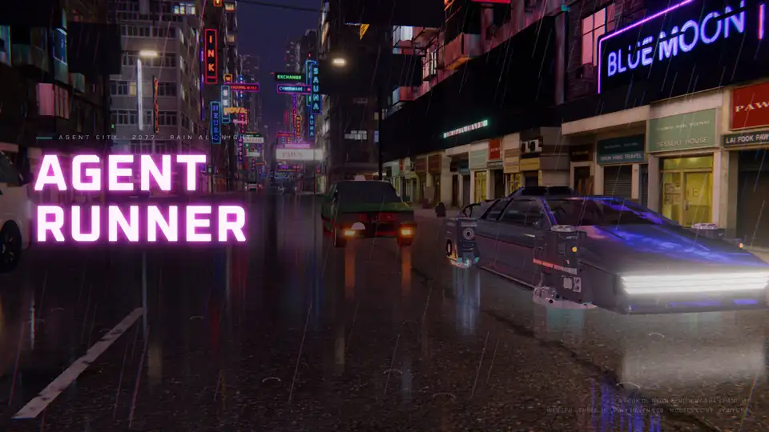
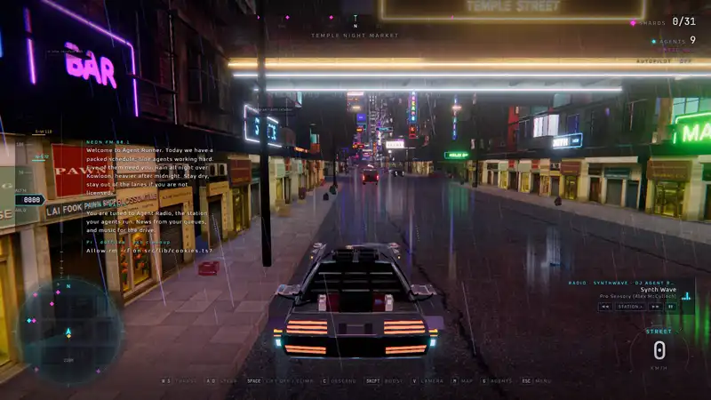
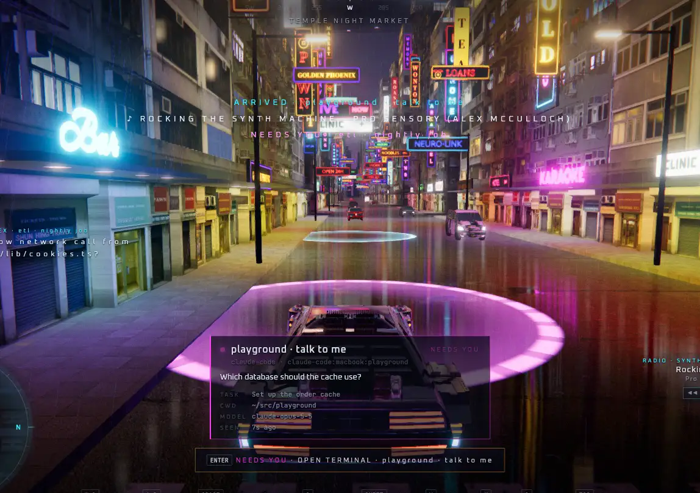
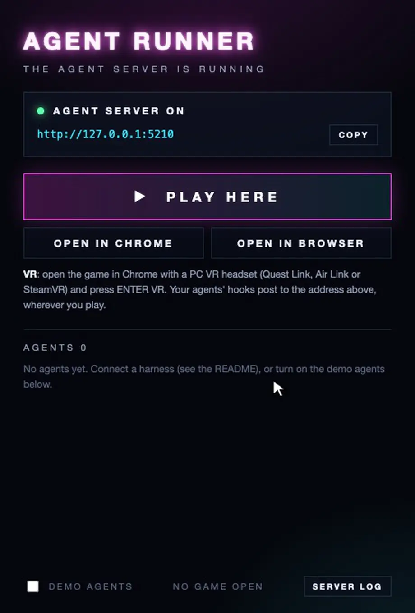

# Agent Runner



**Your AI agents live in a rain-soaked neon city.** Each agent you run (Claude Code, Codex, Pi, a deploy bot, any
agent-driven app) gets its own building, with its name in neon on the roof. Light pillars on the roofs show what
every agent is doing. Drive or fly to whoever needs you, pull up at the kerb, and open a terminal that streams the
agent's output live. Answer it from there: pick an option, type, or hold a key and say it. Agents can put posters
about their work up on the city's LED billboards.

Agents report in with one HTTP POST, so any harness can connect through a hook, a skill or a three-line script.
For Claude Code there is a mod that connects every session, in any terminal, with one command.

<table>
  <tr>
    <td width="50%" valign="top"><br><sub><b>Drive to an agent.</b> Choose it in the agents list (<code>G</code>) and press <code>P</code>: the autopilot follows the satnav, lands at the agent's kerb and gives you the car back with its card up.</sub></td>
    <td width="50%" valign="top"><br><sub><b>Over the roofs.</b> Lift off and boost down the avenues between the sky lanes, at nearly 390 km/h, with the towers of the centre ahead.</sub></td>
  </tr>
  <tr>
    <td colspan="2"><br><sub><b>Answer it.</b> The agent's terminal lists its options: click one, press its number, step through them with the d-pad, or hold <code>Space</code> and say "select two". Speech is heard on your machine. Here the playground, a demo agent, asks which database to use, then for permission to run a command.</sub></td>
  </tr>
</table>

This is a fork of [**Neon Zenith**](https://github.com/billpwchan/neon-zenith) by Bill Chan (MIT): the city, the
flying car, the rendering and the weather are all his. The original README, with how the city is built, is in
[docs/NEON-ZENITH.md](docs/NEON-ZENITH.md). The third-party models and textures keep their own licences
([CREDITS.md](CREDITS.md)).

## Get started

### 1. Install the app (macOS)

1. Download `agent-runner-<version>.dmg` from the [latest release](https://github.com/walm/agent-runner/releases/latest),
   open it and drag **Agent Runner** to Applications. It runs on Apple Silicon and Intel Macs.
2. The app is signed ad hoc, not notarised, so macOS refuses to open a downloaded copy ("damaged" or "cannot be
   verified"). Clear the download flag once, in Terminal:

   ```bash
   xattr -dr com.apple.quarantine "/Applications/Agent Runner.app"
   ```

3. Open Agent Runner. It starts the agent server on `http://127.0.0.1:5210` and shows its console: **PLAY HERE**
   starts the game in the window, **OPEN IN CHROME** and **OPEN IN BROWSER** in a browser. Closing the window keeps
   the server running for your agents; quitting the app stops it.

Not on a Mac, or want to change it? [Run it from source](#run-from-source) on any system with Node and a WebGPU
browser (Chrome or Edge).

### 2. Connect Claude Code

In Claude Code, install the mod from this repository:

```
/plugin install agent-runner --marketplace walm/agent-runner
```

(or from a shell: `claude plugin install agent-runner --marketplace walm/agent-runner`). From then on every Claude
Code session reports to the city: it gets a building in Temple Night Market named after its folder, its terminal in
the game shows its prompts, tool calls and replies, and what you pick, type or say in the game goes back into the
session, wherever it runs (any terminal, an editor, the desktop app), also while it sits idle. Sessions started
while the app is closed show up as soon as it opens.

It needs a recent Claude Code (2.1.3xx, with function hooks). Settings, under `/config` > agent-runner: the server's
address (default `http://127.0.0.1:5210`, the app's) and its token, if you set one. Codex, scripts and other
harnesses: see [Connect a harness](#connect-a-harness).

### 3. Demo agents on or off



The app starts with **demo agents**, so the city has someone in it before your own agents arrive: made-up Claude
Code, Codex, Pi and deploy-bot sessions that work, finish, fail and wait for you, and **playground · talk to me**, which
asks questions and permission prompts you can practise answering (see [Talk to your agents](#talk-to-your-agents)).

Turn them off, or back on, with **DEMO AGENTS** at the bottom of the console, or **Agents > Demo Agents** in the
menu bar. The app remembers. The server restarts to do it: sessions with the mod show again within seconds, agents
on hooks with their next event.

From source, `npm run dev` runs with the demo agents and `npm run dev:nomock` without.

<br clear="right">

## Run from source

```bash
npm install
npm run dev          # agent server on :5210 with the demo agents, game on http://127.0.0.1:5200
```

Open http://127.0.0.1:5200 and choose FREE RIDE. `npm run dev:nomock` starts without the demo agents.

|                                                               |                                                                                                                                                                                                                                                                                                                                                                                                                                                                                                                                                                                                                                                                                                                                               |
| ------------------------------------------------------------- | --------------------------------------------------------------------------------------------------------------------------------------------------------------------------------------------------------------------------------------------------------------------------------------------------------------------------------------------------------------------------------------------------------------------------------------------------------------------------------------------------------------------------------------------------------------------------------------------------------------------------------------------------------------------------------------------------------------------------------------------- |
| `G` or click the **AGENTS** counter (X on a gamepad)          | List every agent, sorted by who needs you. `↑ ↓` to choose, `Enter` to **drive** there (sets a waypoint), `P` (or **AUTO**) to have the **autopilot** drive you there, `W` to **warp** to the kerb outside. On a gamepad: the stick or d-pad chooses, A drives, the right stick press autopilots, Y warps, B closes.                                                                                                                                                                                                                                                                                                                                                                                                                                                                                                                         |
| Pull up in the ring at the kerb, or fly into the agent's beam | A card shows who the agent is and what it last said; `Enter` opens the **terminal**: the agent's output with colours, plus task, cwd, model and uptime. `↑ ↓` `PgUp PgDn` `Home End` (or a gamepad's sticks, d-pad, LB / RB) read back; `Enter` again types to the agent (`Enter` sends, `Esc` leaves the box); `Esc` (or B) to leave. Replies show as Markdown: tables, lists, code and the rest.                                                                                                                                                                                                                                                                                                                                                                                                                                                                                |
| `Space` held in a terminal (X on a gamepad, or the HOLD TO TALK button) | **Talk to the agent**: say it, let go. "Select 2", "select b" or an option's own words pick that option; "yes", "go", "that's okay" accept; "no" declines; "stop" interrupts; anything else is sent as a message. See [Talk to your agents](#talk-to-your-agents). |
| `1`–`9` in a terminal, or the gamepad's d-pad and A | Pick one of the agent's options while it waits at a choice. |
| `M` (Back on a gamepad)                                       | City map with every agent marked by status. Click to set a waypoint; on a gamepad the left stick pans, the triggers zoom and A sets the waypoint at the crosshair.                                                                                                                                                                                                                                                                                                                                                                                                                                                                                                                                                                            |
| A waypoint                                                    | Satnav: a display floating ahead of the car shows the next turn and how far it is, chevrons on the road mark the way in your lane, and both maps draw the route. Leave it and it plans again from where you are.                                                                                                                                                                                                                                                                                                                                                                                                                                                                                                                              |
| WASD / Space / C / Shift                                      | Drive, lift off and climb, descend, boost (as in Neon Zenith).                                                                                                                                                                                                                                                                                                                                                                                                                                                                                                                                                                                                                                                                                |
| `Esc`                                                         | The menu: resume, back to the street, end a run, or **quit to the main menu** (`Q`), where the car parks and the title film plays again.                                                                                                                                                                                                                                                                                                                                                                                                                                                                                                                                                                                                      |
| `P`, the AUTOPILOT chip (top right) or the menu               | **Autopilot**: OFF, AGENT, CRUISE, TURBO, TOUR (below). Touch the controls and you have the car back.                                                                                                                                                                                                                                                                                                                                                                                                                                                                                                                                                                                                                                         |
| Gamepad                                                       | Everything works from the pad. Driving: triggers thrust and brake, left stick steers, right stick climbs and descends, RB boosts. Buttons: **A** does what `Enter` does (the terminal at an agent's door, a run at its beacon), **B** horn, **X** the agents list, **Y** camera, **Start** the menu (and the game from the title), **Back** the map, right stick press the autopilot. The d-pad is the radio: up on and off, left and right the previous and next track, down the next station. In the title, the menu and the results, the d-pad or the left stick moves a highlight, A picks, B goes back, LB and RB step the tabs, and left and right move a slider. The HUD's hints switch to the pad's buttons when it was touched last. |

Keys with a modifier held (`Cmd`/`Ctrl`/`Alt`) are left to the browser and the system: reloading with `Cmd R` does not reset the
car, and `Cmd M` minimises instead of opening the map.

**Autopilot** (`P` steps through the modes; the gamepad's right stick press too):

- **AGENT** drives to the agents that need you (waiting on you first, then failed), by the satnav: its route on the
  maps and the display ahead of the car. The long way it flies over the streets at 50 m; the last 150 m it comes
  down to 6.5 m over the traffic, in the left lane, and lands at the agent's kerb, where `Enter` opens the
  terminal. It waits there while the agent still needs you, then goes on to the next. With nobody waiting it calls
  on the others in turn, for a little while each.

  **To one agent**: `P` or **AUTO** in the agents list (the right stick press on a gamepad) drives to that agent
  and no other, lands at its kerb, stops, and gives you the car back with its card up. `P` while you drive to an
  agent's waypoint does the same for that agent. Touch the controls on the way and the car is yours, with the
  waypoint kept.
- **CRUISE** wanders the street canyons at 95 m, at an easy pace, among the towers.
- **TURBO** keeps to the avenues at 50 m and boosts down the long straights, past 100 m/s.
- **TOUR** visits every district, nearest first, and laps the Zenith's block; at each, NEON FM says a word about
  it (read out with RADIO VOICE on).

The flying modes keep to the streets, which are open all the way up, and to heights between the sky lanes; they
slow for corners, climb or dip for signs and awnings, pull out to the middle of the street before they take off,
and back off if they ever get stuck. Starting a run, or any throttle, steering, lift or boost of yours, turns it off.

Every agent's building has a neon sign with its name on the roof, at the street edge, lit in its status colour.
Agents can also put up a **billboard**: a poster about their task (an image they made, or a title and caption the
city designs a poster around) that rotates on the LED screens across the city. See
[Billboards](docs/AGENT-API.md#billboards); for Claude Code there is a skill that draws one.

**Voice** (Settings > VOICE, off by default): text read out loud in
[Supertonic 3](https://huggingface.co/supertone-oss-archive/supertonic-3)'s voice "Sarah", English, at 1.25×. VOICE
loads it; what it reads is up to two settings under it. AGENT VOICE reads when an agent's task finishes or fails
("infra finished: …"), or every message line, or nothing. RADIO VOICE reads the radio: the DJ's announcements and
NEON FM's own chatter. It runs
in the browser, in a worker (WebGPU, else WebAssembly). Turning it on the first time downloads the model (about
400 MB) through the agent server, which keeps it on disk in `~/.cache/agent-runner` (set `AGENT_CITY_CACHE` to move
it), so later starts load it in a second, in the desktop app too. Served from a static host without the agent server,
the game fetches it from Hugging Face into the browser's cache instead. Tool calls and your own prompts are not
read, one line waits per agent, and the radio goes first. Nothing is spoken until the game's sound has started (a
key or a click).

**Radio** (the RADIO menu; `B` on and off, `N` the next track): NEON FM, the city's own synthesised score that
follows your speed and height, or the **music library**: eight CC0 synthwave, cyberpunk and ambient tracks (the
agent server downloads each the first time it plays and keeps it in `~/.cache/agent-runner`), plus your own files
in `~/Music/Agent Runner`, a folder per category. Spotify, YouTube Music and Apple Music are listed as coming: the
player in [src/audio/music.js](src/audio/music.js) takes sources behind one interface, ready for them.

An agent can be the radio's **DJ**: pick the music by category and put announcements on the air between tracks
or over them, read out in the agent voice. A summary of a Slack channel, the pull requests waiting for you, a
deploy that finished: what it says is up to you. See [The radio](docs/AGENT-API.md#the-radio),
[integrations/generic/radio.sh](integrations/generic/radio.sh), and two example DJs in
[integrations/radio](integrations/radio). AGENT DJ in the menu turns it off, and your own picks win until the DJ
picks again. The lower right corner of the HUD shows what plays, ON AIR while the radio speaks, and buttons to
change it: ◀◀ and ▶▶ for the track, STATION ▸ through NEON FM, all the music and each category, and on / off. The first ride
opens with the radio's welcome: how many agents are on shift and how many need you (what the DJ said while you
sat on the title follows it).

To hear a DJ before you set one up: `npm run dev` has a demo DJ with the mock agents, and `npm run radio:demo`
puts the same show on the air of any running server (the desktop app's too): made-up news from GitHub, Slack, CI
and the calendar every 45 seconds, with music picked to go with it.

**Volume**: Settings has MASTER, BACKGROUND (rain, the city, the car), RADIO / MUSIC and VOICE (the agents and the
DJ), each on its own.

**Quality** (Settings): AUTO steps the rendering resolution down when frames are missed and probes back up when
they are clean; the wet street's mirror and the car's reflection probe (each another drawing of the city) follow
it down. HIGH, MEDIUM and LOW fix it. The HUD is not drawn while a menu covers it or while it is off, and never in a
headset.

Status colours: **cyan** working · **magenta** pulsing, needs you · **red** error · **green** done · **amber** idle · **grey** offline (silent for 15 minutes).

You are notified when an agent starts waiting for you, fails or finishes. "Needs you" also comes over the radio.

Each harness has its own neighbourhood:

- `claude-code`: Temple Night Market, around the spawn point
- `codex`: Yau Ma Tei
- `pi`: Sham Shui Po
- `gemini`: Jordan
- everything else: Kowloon City

An agent's id hashes to a building, so it gets the same building every time.

Debug: `?play&agent=<id or part of a name>` starts the game parked outside that agent.

## Desktop app (macOS)

`npm run app:build` packages the city as a Mac app with [MyGo](https://mygo.egoist.dev):
`desktop/build/darwin-arm64/Agent Runner.app` and a disk image beside it. It needs Go 1.27+ and Bun.

- The app runs the agent server inside it (compiled by Bun into one executable) on `127.0.0.1:5210`, where the
  hooks already post, so Claude Code, Codex and the scripts reach it unchanged.
- It opens as a small **server console**: the server's address (with COPY, for a harness's hooks), its agents live,
  and where to play. **PLAY HERE** grows the window to the size the game had last time and loads the game in it.
  **OPEN IN CHROME** and **OPEN IN BROWSER** play it there instead, with the window staying the console: Chrome is
  the way to VR with a PC headset (Quest Link, Air Link, SteamVR). **View > Server Console** (`⌘1`) goes back,
  **View > Play Here** (`⌘2`) forward.
- **Agents** menu: **Demo Agents** turns the mock agents on or off (on at first; the app remembers),
  **Copy Agent Server URL**, and **Show Server Log** (`~/Library/Logs/Agent Runner/server.log`).
- Closing the window keeps the app and its server running, so agents keep reporting; the Dock icon brings the
  console back. Quitting stops the server.
- When something else holds port 5210 (`npm run dev`, say), the app runs its server on another port and says so
  in its window title and the console. Hooks that post to 5210 then reach the other server.
- `NCA_DIAG=1` (run the executable in `Contents/MacOS/` from a terminal) logs how far the page got every few
  seconds to `~/Library/Logs/Agent Runner/page.log`: the loader, the graphics backend, frames, errors.
  `NCA_QUERY='?webgl'` adds a query to the game's URL, to try the game's switches, and `NCA_PLAY=1` starts
  straight in the game.
- `npm run app:dev` runs it from source (the server with Node, the game from `dist/`).
- The build is signed ad hoc: it opens on the Mac that built it. For other Macs, set `macos.signingIdentity` and
  `macos.notarize` in `desktop/mygo.config.ts` ([MyGo's distribution docs](https://mygo.egoist.dev/docs/distribution)).
  The compiled server is a Bun executable, which needs the JIT entitlements under the hardened runtime
  (`macos.helperEntitlements`).
- **Releases**: every pull request merged into `main` builds a universal app (Apple Silicon and Intel) on GitHub
  Actions and publishes its disk image as a release tagged `v<version>-pr<number>`
  (`.github/workflows/release.yml`; Actions > release > Run workflow releases `main` by hand). Those builds are
  signed ad hoc too: after installing, clear the download flag with
  `xattr -dr com.apple.quarantine "/Applications/Agent Runner.app"`.

## VR (Meta Quest)

Open the game in the Quest browser and press **ENTER VR** (top left; it only shows when the browser has a headset).
You sit in the car's seat, with a dash under your view; the agents list and the terminal open as panels in front of
you, and name tags float over the agents' roofs.

| Touch controller             |                                                                                    |
| ---------------------------- | ---------------------------------------------------------------------------------- |
| Right trigger / left trigger | Throttle / brake and reverse (the left stick's Y works too)                        |
| Left stick X                 | Steer                                                                              |
| Right stick Y                | Climb and descend                                                                  |
| Grip (either)                | Boost                                                                              |
| **A**                        | Open the terminal at an agent's kerb or in its beam (or start a run at its beacon) |
| **X**                        | Agents list: stick to choose, **A** drive, **trigger** warp, **B** close           |
| **Y**                        | Seat view or chase view                                                            |
| Right stick (terminal)       | Scroll back; **A** or **B** closes                                                 |

Hold the Meta button to recenter.

WebXR only runs on `https` or `localhost`: over plain `http://<your-ip>:5200` the game loads but ENTER VR never
appears. Three ways to the headset:

- **Same Wi-Fi:** `npm run dev:lan` serves Vite on every interface over https with a self-signed certificate. Open
  `https://<your-computer's-ip>:5200` on the Quest and accept the certificate warning once (Advanced, then
  Proceed).
- **ngrok:** `npm run dev`, then `ngrok http 5200 --basic-auth "you:a-long-password"` and open the https URL it
  prints.
- **USB:** with developer mode on, `adb reverse tcp:5200 tcp:5200` and open `http://localhost:5200`.

Live reload works with all three. The agent server stays on 127.0.0.1; the headset reaches it through Vite's `/api`
proxy. That proxy also carries your agents' terminal output and accepts events, so `dev:lan` opens both to your
network and ngrok to anyone holding the URL. Keep the basic auth on ngrok when real agents report in.

What differs from the screen:

- **No post chain in a headset** (no bloom, grade or wet-street mirror; three.js turns screen-space passes off in
  XR). The scene is tone-mapped by the renderer, a little brighter to make up for the missing bloom.
- **WebGL**: WebXR over WebGPU is not in any headset browser yet, so with a headset present the game starts on WebGL.
- **Multiview**: both eyes are drawn in one pass where the browser has `OVR_multiview2` (the Quest does). `?nomv`
  turns it off.
- **VR DETAIL** (Settings): what a headset gets of the city. AUTO is LOW on a standalone headset (Quest, Pico) and
  HIGH on a PC headset; `?vr=low|medium|high` overrides it.
  - LOW: 75% resolution, photo facades only (no modelled ones), shopfronts within 40 m, Temple Street's props at
    lower detail, a simplified car, no sky traffic, thinner rain, a shorter far plane, a slow car-reflection probe.
  - MEDIUM: 90% resolution, low-detail modelled facades within 60 m, shopfronts within 70 m, the rest as LOW but
    less so.
  - HIGH: the whole city.

  The dash shows the frame rate. TRAFFIC (Settings) thins out the other cars, on the screen too.

- **A wait on entering**: every shader is built again for the headset in the background, about 25–35 s on a Mac.
  It shows a notice in the meantime.

No headset? `?xremu` (dev server only) installs Meta's WebXR emulator (IWER) as a Quest 3; the controllers are
driven from the console through `__xrdevice.controllers.left/right`.

## Talk to your agents

Open an agent's terminal, hold **Space** (X on a gamepad, or the **HOLD TO TALK** button), say it and let go. Or
type it: `Enter` moves into the box under the terminal, `Enter` sends, `↑` brings back what you sent before, and
`Esc` leaves the box. Typed words mean the same as said ones ("select 2", "yes", a message). The
words are heard on your machine by [Whistle](https://huggingface.co/Cactus-Compute/whistle), a 17 MB speech model
that runs in the browser (in WebAssembly, on the CPU); the sound never leaves the machine. The agent server works
out what the words mean where the agent is, and types them into the agent's own terminal:

| The agent shows | You say | It gets |
|---|---|---|
| A choice (a permission prompt, a question with options) | "select 2", "option two", "the second one", "select b" | the key `2` (letters count a = 1, b = 2) |
| | the option's own words ("SQLite", "yes, and don't ask again") | that option's number |
| | "yes", "go", "okay", "that's okay", "do it" | Enter (the highlighted option, Yes) |
| | "no", "deny", "cancel" | Escape |
| | anything else | Escape, then your words as a message |
| A prompt, or it is working | anything | your words and Enter (a working Claude Code queues it) |
| It is working | "stop", "wait", "cancel" | Escape, which interrupts it |

While an agent waits at a choice, its options are listed under its terminal as well: click one, press its number
(top row or number pad), or move through them with the gamepad's d-pad and pick with A (B still closes). For a choice
whose options the hooks do not send, the list is YES and NO.

**Practise on the playground.** With the mock agents on (`npm run dev`, or Agents > Demo Agents in the app), the
agent **playground · talk to me** in Temple Street keeps asking: a question with options, a permission prompt, then
"what next?" at its prompt. It reacts to what you say or pick the way Claude Code would, without a terminal of its
own.

The line under the terminal shows what was heard and what was pressed, and the terminal shows it too. The first
time, the browser asks for the microphone, and the model (17 MB) is fetched once into the server's cache.
**TALK LANGUAGE** in Settings is English unless you change it: English, German, French, Spanish, Italian, Dutch and
Polish, or AUTO to detect it (short phrases are heard better with the language set).

**Claude Code with the mod** (below, [Connect a harness](#connect-a-harness)) needs nothing else: the mod takes what
you say inside Claude Code itself, in any terminal or editor. A message becomes a prompt (also when the session sits
idle), an answer to a question or a permission prompt answers that dialog (the one in the terminal stays up too,
and the first answer wins), and "stop" ends the turn.

**Where it can type, without the mod.** The hooks send the agent's process id (`pid=$PPID` in
[settings.example.json](integrations/claude-code/settings.example.json) and the Codex script), and the server finds
the terminal that runs it:

- **tmux** (any OS): the agent's pane.
- **Ghostty**, **iTerm2** and **Terminal** (macOS): by AppleScript. macOS asks once whether the app running the
  server (Agent Runner, or the terminal running `npm run dev`) may control that terminal. Ghostty is matched by
  the agent's folder, so with two Ghostty terminals in one folder the one titled by Claude Code is picked, or none.
- **Anything else** (an IDE's terminal, an agent on another machine): the words wait in the agent's inbox,
  `GET /api/agents/<id>/inbox`, for a script of yours to read.

Hooks set up before this existed still work in tmux and Ghostty when only one terminal is in the agent's folder;
add `&pid=$PPID` to their URLs for the rest. `AGENT_CITY_INPUT=off` on the server stops all typing (the inbox
still fills). Typing into a terminal is as good as sitting at it, so only the game itself can do it: the request
needs a header another site cannot send, and with `AGENT_CITY_TOKEN` set, open the game with `?token=<token>`.

## Connect a harness

The full API is in [docs/AGENT-API.md](docs/AGENT-API.md). The short version:

```bash
# any script: one JSON event (every field but "agent" is optional)
curl -s localhost:5210/api/events -H 'Content-Type: application/json' -d '{
  "agent": "my-bot:prod", "harness": "my-bot", "name": "crawler",
  "status": "working", "message": "Crawling page 3", "text": "fetched 120 urls\n"
}'

# no JSON at all: the body is the text, the rest goes in the query
some-command 2>&1 | integrations/generic/post-event.sh my-bot:prod --stream
integrations/generic/post-event.sh my-bot:prod waiting "Approve the deploy?"
```

- **Claude Code, the mod** (recommended): in Claude Code, run

  ```
  /plugin install agent-runner --marketplace walm/agent-runner
  ```

  (or, from a clone, `claude plugin marketplace add /path/to/agent-runner` and `claude plugin install
  agent-runner@agent-runner`). Every session then reports to the city and can be answered from the game, in any
  terminal or editor, with no hooks to edit. The mod waits quietly while no Agent Runner is running and links up when
  one starts, so a session started before the game still shows, with its recent history. Its settings (`/config`,
  agent-runner): the server's address and token. Needs a recent Claude Code (2.1.3xx). More in
  [its README](integrations/claude-code-mod/agent-runner/README.md).
- **Claude Code, hooks** (older Claude Codes, or no mod): merge the `hooks` block from
  [integrations/claude-code/settings.example.json](integrations/claude-code/settings.example.json) into
  `~/.claude/settings.json` (all projects) or `.claude/settings.json` (one project). Each hook pipes Claude Code's
  own hook JSON to `POST /api/hooks/claude-code`, which maps it as follows:
  - prompt → working
  - tool calls → terminal lines
  - permission prompt or a question with options → needs you (and you can answer it out loud)
  - stop → done

  There is one building per host and working directory. Use the hooks or the mod, not both: each would report the
  same session.

- **Codex**: point `notify` in `~/.codex/config.toml` at
  [integrations/codex/notify.sh](integrations/codex/notify.sh). Codex only reports at the end of each turn.
- **Billboards**: copy [integrations/claude-code/skills/city-billboard](integrations/claude-code/skills/city-billboard)
  to `~/.claude/skills/`, then ask Claude to "put up a billboard for this task". Other agents and scripts use
  [integrations/generic/billboard.sh](integrations/generic/billboard.sh). The details are in
  [docs/AGENT-API.md](docs/AGENT-API.md#billboards).
- **Anything else**: [integrations/generic/post-event.sh](integrations/generic/post-event.sh) or a plain `curl`.
  Pi, Gemini and others go here until they get an adapter in `server/adapters.mjs`.

Set `AGENT_CITY_TOKEN` on the server to require `Authorization: Bearer <token>` on every POST. Set `AGENT_CITY_URL`
for the scripts when the server runs somewhere else. The server listens on 127.0.0.1 unless you set `HOST`.

## Scripts

|                                       |                                                                                  |
| ------------------------------------- | -------------------------------------------------------------------------------- |
| `npm run dev`                         | Server with mock agents, plus Vite (proxies `/api` to the server)                |
| `npm run dev:lan`                     | The same, with Vite over https on every interface (for a headset on the LAN)     |
| `npm run server` / `server:mock`      | The agent server alone (port `PORT`, default 5210)                               |
| `npm run mock`                        | Mock agents posting over HTTP to a running server (`--url`, `--fast`, `--token`) |
| `npm run radio:demo`                  | A demo DJ on a running server's radio (`AGENT_CITY_URL`; `-- --every 30`)        |
| `npm test`                            | Server unit tests (`node --test`)                                                |
| `npm run build` then `npm run server` | Production: the server also serves `dist/` on :5210                              |
| `npm run app:build` / `app:dev`       | The macOS app (see [Desktop app](#desktop-app-macos))                            |

## Layout

```
server/        index.mjs (HTTP + SSE, no dependencies) · store.mjs (agents, output buffers) · adapters.mjs (harness hooks) · music.mjs (the radio's library and DJ) · models.mjs (the voice and speech models) · typer.mjs (typing into an agent's terminal) · cache.mjs (downloads kept on disk) · mock.mjs · playground.mjs (a mock agent to talk to)
src/agents/    feed (SSE client) · placement (agent → building and kerb) · visuals (roof pillars, kerb rings)
               labels (name tags) · signs (neon name on the roof) · billboards (posters on the LED screens)
               panel (the G list) · terminal (xterm.js) · agents (glue to the game)
               talk (push to talk) · stt.worker (Whistle) · intent (what "select 2" or "yes" means at a prompt)
src/game/      nav (the satnav's routing over the street grid) · navvis (the chevrons and the display ahead of the car) · autopilot (the car driving itself)
src/audio/     audio (the synthesised world, NEON FM and the mix) · music (the radio's player and its sources) · voice (the agents and the DJ read out) · tts.worker (Supertonic 3)
src/xr/        vr (session, seat, controllers, light profile) · panels (dash, list, terminal in canvases) · tags
integrations/  claude-code-mod (the mod) · claude-code (hooks, the city-billboard skill) · codex · generic (post-event.sh, billboard.sh, radio.sh) · radio (example DJs)
desktop/       the macOS app (MyGo): main.go runs the compiled server and shows the game; scripts/build.mjs builds both
```

The game-side changes to upstream files are small: `src/main.js`, `src/game/game.js`, `src/core/input.js` and
`src/ui/screens.js` (agent hooks, the G key, the legend, the rebrand), plus `vite.config.js` for the proxy.
